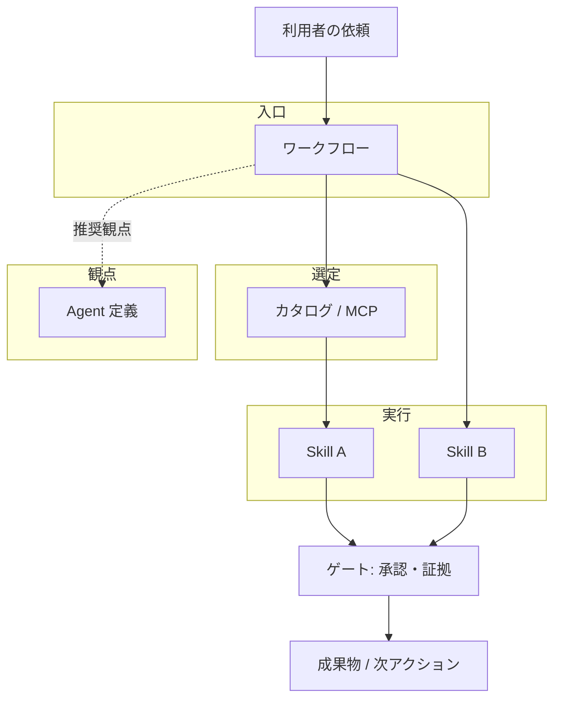

# 方法論 — Skill・Agent・ワークフロー

> **§0 一文**: エージェントが手順と役割を飛ばさないよう、**ワークフローがプロセスを所有し、スキルが手順を供給し、エージェント定義が観点を固定する**三層で問題を解く。

## 1. 解く問題

| 症状 | 原因（構造） | 本方法論の答え |
|---|---|---|
| 同じ依頼で毎回手順が違う | プロセスがモデルの即興に委ねられている | **ワークフロー**が入口と skill 鎖を所有 |
| skill があるのに読まれない | 全文投入・一覧過多で選定が散文化 | **カタログ／MCP**で候補選定→必要分だけ開く |
| レビュー・法務がスキップされる | 完了定義とゲートが契約に無い | **ゲート**（承認・証拠・失敗観察）をワークフローに埋め込む |
| 「誰の目線で見たか」がぶれる | 役割が会話ごとに漂移 | **エージェント定義**で観点を名前付きで参照 |

目標はエージェントを細工で縛ることではなく、**再現可能なオーケストレーション**を用意すること。

## 2. 三つの構成要素

### 2.1 ワークフロー（Workflow / command）

- **定義**: ある成果物や判断を届けるまでの**プロセスの所有者**（`.kilo/commands/<name>.md`）。
- **持つもの**: ステップ順、呼ぶ skill の鎖、出力の形、ゲート、推奨 `agent:`（進行役の観点）。
- **持たないもの**: 各ステップの詳細手順（それは skill に委ねる）。
- **比喩**: レシピの「工程表」。何番目に何の技法を使うかまで書くが、技法の教科書本文は別冊。

**設計原則（ワークフロー主導）**: agent が skill を勝手に省略する前提で、**ワークフローが明示的に skill を呼ぶ**（commands README と同じ）。

### 2.2 スキル（Skill）

- **定義**: 一つの能力・手順の**実行可能な仕様**（`.kilo/skills/<name>/SKILL.md`）。
- **持つもの**: いつ使うか（description）、手順、チェックリスト、参照（`references/`）、必要ならゲート文言。
- **持たないもの**: エンドツーエンドの納品プロセス全体（それはワークフロー）。
- **比喩**: 単技のマニュアル。複数をつなぐのはワークフローの仕事。

**設計原則（段階的開示）**: 入口 `SKILL.md` は小さく保ち、長文は `references/`。カタログは 1 行説明のみ（`CAPABILITIES.md` / MCP）。

### 2.3 エージェント（Agent）

- **定義**: **観点・責務・モード**の名前付きラベル（`.kilo/agents/<name>.md`）。別人格の常駐プロセスではない。
- **持つもの**: この役割で何を優先し、何を禁止するか（レビュー軸、進行、法務チェックの立ち位置など）。
- **持たないもの**: ステップバイステップの実装手順（skill）や全体フロー（workflow）。
- **比喩**: 役割カード。「今から code-reviewer の観点で読む」と宣言するための SSOT。

**Cursor 等での使い方**: ネイティブ切替はできないため、`@.kilo/agents/<role>.md` を読んで**その観点を適用**する。

## 3. 関係（誰が誰を呼ぶか）

| 矢印 | 意味 |
|---|---|
| 依頼 → ワークフロー | **必ず入口を一つ選ぶ**（迷ったら `ask-matt` またはカタログ） |
| ワークフロー → skill | 本文に列挙された skill を**必要分だけ**開く |
| ワークフロー → agent | 進行・レビューの**観点**として参照（手順の代替ではない） |
| skill → ゲート | スキル／ワークフローに書かれた停止条件を飛ばさない |

## 4. 呼び出しプロトコル（WARO）

運用契約の要約。詳細は [AGENTS.md](../AGENTS.md)。

| 段 | 名前 | 行動 |
|---|---|---|
| **W** | Workflow | 入口 command を選び、出力スキーマを確認 |
| **A** | Acquire | `capabilities` / `skill_search` で候補を絞る（全部読まない） |
| **R** | Read skill | ワークフローが指定した `SKILL.md` だけ開く |
| **O** | Observe & Output | ゲートを通し、証拠付きで成果物を出す |

## 5. いつ何を足すか（設計判断）

| 欲しいもの | 追加する層 | 例 |
|---|---|---|
| 新しい単技（テストの書き方、法務チェックリスト） | **Skill** | `tdd`, `compliance-legal` |
| 新しい観点（セキュリティレビュアの目線） | **Agent** | `security-reviewer` |
| 新しい納品経路（UI 変更の標準ルート） | **Workflow** | `/ui-delivery` |
| 候補が多すぎて選べない | **カタログ／MCP** | 再生成 `gen_capabilities.py`、説明文の改善 |
| 外部前提（issue tracker 未設定） | **Readiness** | `scripts/readiness.json` で標準フローから外す |

**アンチパターン**

- 巨大な skill 1 本にワークフロー全文を入れる → 読まれない。ワークフローと skill を分離。
- agent に実装手順だけ書く → 観点が再利用できない。手順は skill に。
- 55 skill を毎回プロンプトに貼る → コンテキスト枯渇。カタログ＋段階的開示。

## 6. ゲート（品質の止めどころ）

すべてのワークフローで共通の**完了の定義**に使う。

| ゲート | 意味 |
|---|---|
| **承認** | 破壊的変更・本番・削除・外部送信・契約は人が決める |
| **証拠** | コマンド・diff・ログ。推測と実測を分ける |
| **失敗観察** | 起きた失敗に基づき直す（想像上のリファクタだけにしない） |

法務・プライバシー系 skill は**判断をエージェントに委ねない**（チェックリストと証拠まで）。

## 7. コンテキスト予算（方法論の制約）

モデルに渡す情報量も設計の一部。

- 契約・カタログ・ワークフロー・skill は**上限あり**（[AGENTS.md](../AGENTS.md) §4）。
- **SSOT を一つ**: 同じ手順を README と skill に二重に書かない。正本は skill。
- 大きい skill は `references/` に逃がし、入口だけ先に読む。

## 8. ツールとの対応

| 環境 | ワークフロー | Skill | Agent | 選定 |
|---|---|---|---|---|
| Kilo | `/name` | 自動／明示参照 | `agent:` 推奨 | MCP・`.kilo/` |
| Cursor | `@commands/...` | `@skills/.../SKILL.md` | `@agents/...` | MCP・`@CAPABILITIES.md` |

## 9. 受入（この方法論が効いているか）

| id | 確認 | Pass |
|---|---|---|
| M1 | 依頼が常にいずれかのワークフロー（またはその省略根拠）に乗る | 会話ログで入口が言える |
| M2 | 使った skill がワークフローまたはカタログ選定で説明できる | パスが残る |
| M3 | ゲート該当時に停止または承認依頼がある | 本番直叩き無し |
| M4 | 同種タスクの手順が再現できる | 2 回目以降も同じ鎖 |

## 10. 関連文書

| 文書 | 用途 |
|---|---|
| [USAGE.md](./USAGE.md) | ツール別の操作 |
| [AGENTS.md](../AGENTS.md) | エージェント契約（必須） |
| [README.md](../README.md) | 概要・収録 |
| `.kilo/commands/README.md` | ワークフロー一覧 |

---

**更新**: 方法論の変更は `AGENTS.md` の呼び出しプロトコルと矛盾させない。矛盾したら **AGENTS.md を正本**として本書を直す。
