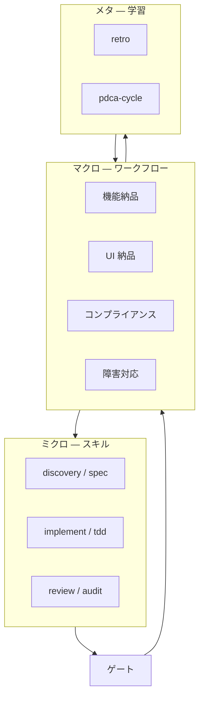

# 工程思想論 — 届けるまでのプロセスを理論として扱う

> **§0 一文**: ソフトウェア作業を「コードを書く瞬間」だけにせず、**意図→決定→実装→検証→承認→学習**の工程を明示的な所有物として設計し、エージェントの即興に委ねない。

本書は [METHODOLOGY.md](./METHODOLOGY.md)（Skill／Agent／ワークフローの**構造**）を補う、**時間軸・品質・認識**の理論。運用契約は [AGENTS.md](../AGENTS.md)。

---

## 1. 立場：プロセスは成果物の一部

| よくある誤解 | 工程思想の立場 |
|---|---|
| プロンプトがあれば足りる | プロンプトは**入口**であり、納品の定義ではない |
| 実装が終われば完了 | **検証・ゲート・承認**までが工程の一部 |
| 失敗はその場しのぎ | **観察された失敗**を記録し、環境（手順・チェック）に還元する |
| エージェントが賢ければ順序は不要 | 賢さは**ばらつき**を生む。順序は**再現性**のため |

**定義（工程）**: ある意図を、合意された成果物に変えるための**順序付き変換**と、その各段の**完了条件**の総体。

---

## 2. 二層モデル：マクロ経路とミクロ技法



| 層 | 問い | 典型の所在 |
|---|---|---|
| **マクロ** | 何を届ける経路か | `.kilo/commands`（13 ワークフロー） |
| **ミクロ** | この段でどう手を動かすか | `.kilo/skills` |
| **メタ** | 次回の工程をどう良くするか | `retro`・`pdca-cycle`・`memory` |

**原則**: マクロがミクロを**呼ぶ**。ミクロだけ並べても工程にならない（[METHODOLOGY.md](./METHODOLOGY.md) のワークフロー主導）。

---

## 3. 納品ライフサイクル（一般形）

特定プロダクトに依存しない、工程思想の**抽象ライフサイクル**。

| 段 | 名前 | 目的 | 典型スキル（例） |
|---|---|---|---|
| **D0** | 意図の固定 | 誰のため・何が変われば成功か | `product-discovery`・`research` |
| **D1** | 決定の記録 | 取り返しの難しい選択を残す | `architecture-decision`・`to-spec` |
| **D2** | 実行可能化 | チケット・受入基準に落とす | `to-tickets`・`plan-md` |
| **D3** | 構築 | コード／文書を作る | `implement`・`implement-spec`・`tdd` |
| **D4** | 検証 | 壊れていないことを示す | `test-engineering`・`change-readiness` |
| **D5** | 多面レビュー | 品質・UI・安全の観点 | `code-review`・`accessibility-audit`・`security-review` |
| **D6** | 承認と放出 | 本番・公開は人の判断 | `release-readiness`・`compliance-legal` |
| **D7** | 学習 | 環境と手順を更新 | `retro`・`pdca-cycle` |

`/feature-delivery` は D0–D6 の**標準経路の実装例**。UI・調査・障害・コンプライアンスは別ワークフローが D0 の入口を変える。

**省略規則**: 段を飛ばすときは**理由と証拠**を残す（「小変更なので D1 省略」→ スコープ一文と diff で代替）。

---

## 4. ゲート理論（止めどころの型）

ゲートは「嫌なこと」ではなく、**工程の状態機械における遷移条件**。

| 型 | 符号 | 意味 | 例 |
|---|---|---|---|
| **Gₐ** | 承認 | 人が責任を持つ不可逆操作の前で停止 | 本番・削除・契約・外部送信 |
| **Gₑ** | 証拠 | 主張とログ・diff・コマンド出力の対応 | テスト結果、再現手順 |
| **Gₒ** | 観察 | 実際に起きた失敗に基づく修正 | 推測だけのリファクタを禁止 |

**定理（実務）**: 「完了」宣言は **Gₑ を満たした段**まで有効。Gₐ 該当なら満たしても**未完了**。

法務・プライバシー工程（`/compliance-review`）は **Gₐ の集約**：エージェントはチェックリストと証拠まで、**判断は人**。

---

## 5. トレーサビリティ（意図の連鎖）

工程思想の中心は **一本の鎖**で意図を追えること。

```text
意図 → 発見・スコープ → 仕様／ADR → チケット → 変更 → レビュー → 放出記録 → 振り返り
```

| リンク | 断ち切られると起きること |
|---|---|
| 意図 ↔ 仕様 | スコープクリープ、受入不能 |
| 仕様 ↔ チケット | 実装が別物、レビュー不能 |
| 変更 ↔ 証拠 | 「動いた」が検証不能 |
| 放出 ↔ 学習 | 同型障害の再発 |

`to-spec` / `to-tickets` は鎖の**中間表現**。issue tracker 未設定時は標準工程に載せない（[readiness.json](../scripts/readiness.json)）— 鎖が切れた経路を**黙って使わない**設計。

---

## 6. 認識論：証拠・推測・未検証

工程上の発言は三値に分類する（[AGENTS.md](../AGENTS.md) と一致）。

| 区分 | 定義 | 工程での扱い |
|---|---|---|
| **証拠** | 第三者が同手順で再確認できる | 完了・レビュー合格の根拠 |
| **推測** | 妥当だが未確認 | 仮説として明示し、D4 で検証 |
| **未検証** | まだ見ていない | リリース判断に使わない |

**観察された失敗**（observed failure）: 修正は**再現可能な失敗**から逆算する。想像上のバグ修正は工程を汚す。

---

## 7. 環境反復 vs プロダクト反復

`retro` の思想を理論化する。

| 対象 | 変えるもの | 例 |
|---|---|---|
| **プロダクト反復** | コード・設定・データ | バグ修正、機能追加 |
| **環境反復** | エージェントが働く**周辺** | チェックリスト、rules、skill 文言、CI |

工程思想は両方を認めるが、**同じ会話で混ぜない**。retro は「次の工程を楽にする」メタ工程（D7）。

`pdca-cycle` は環境・プロセス・品質の**小さな仮説実験**用。Act で標準化するか、次のワークフローに取り込む。

---

## 8. 標準経路と例外経路

13 ワークフローは**参照アーキテクチャ**（必須ではないが、迷ったときの SSOT）。

| 経路タイプ | 代表 | 工程上の意味 |
|---|---|---|
| **納品** | `/feature-delivery`・`/ui-delivery` | D0–D6 の製品変更 |
| **判断** | `/research`・`/market-plan` | D0 強化、D6 前の意思決定 |
| **ゲート集約** | `/compliance-review`・`/release-review` | Gₐ・Gₑ の束ね |
| **運用** | `/incident-response` | 時間圧下下的な D4–D7 |
| **計画・報告** | `/sprint-plan`・`/status-report` | 鎖の同期 |
| **メタ** | `/self-review`・`/self-improve` | 品質と工程の自己修正 |

**ルーター** `ask-matt` は標準経路の**索引**（工程の外だが入口選定に使う）。

---

## 9. WARO と工程の接続

[METHODOLOGY.md](./METHODOLOGY.md) の WARO を時間軸に重ねる。

| WARO | 工程段 |
|---|---|
| **W**orkflow | マクロ経路の選択（§8） |
| **A**cquire | D0–D2 の材料収集・チケット化 |
| **R**ead skill | D3–D5 のミクロ実行 |
| **O**bserve & Output | Gₑ・Gₐ・D7 |

---

## 10. 設計への含意（キット作者向け）

1. **新しい工程ニーズ** → まずワークフローか、既存ワークフローの段追加かを決める。  
2. **新しい単技** → skill。既存ワークフローの鎖に**名前で**挿入。  
3. **ゲート** → ワークフロー本文に id 付きで書く（「承認なしで本番」等）。  
4. **Readiness** → 鎖が成立しない前提は標準経路から外す。  

---

## 11. 受入（工程思想が生きているか）

| id | 確認 | Pass |
|---|---|---|
| P1 | 変更に対応するワークフロー（または省略理由）が言える | ログ・PR に一文 |
| P2 | 完了宣言に証拠が付く | Gₑ |
| P3 | 不可逆操作の前に承認がある | Gₐ |
| P4 | 振り返りが環境または手順に還元される | D7 が空でない |

---

## 12. 関連

| 文書 | 内容 |
|---|---|
| [METHODOLOGY.md](./METHODOLOGY.md) | Skill／Agent／ワークフロー三層・WARO |
| [USAGE.md](./USAGE.md) | ツール別操作 |
| `.kilo/commands/README.md` | ワークフロー一覧と skill 鎖 |

**正本の優先**: 工程の必須動作は **AGENTS.md** と各 **command** 本文。本書はその**理論的整理**。
