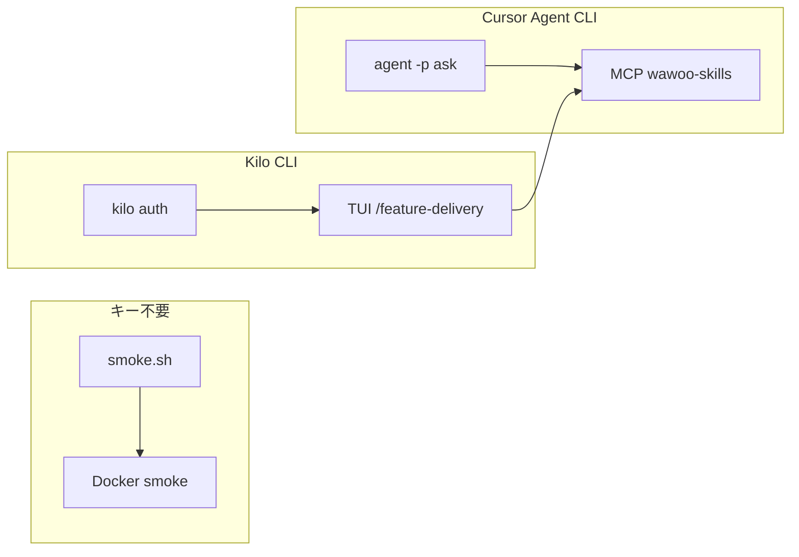

# CLI 実測環境（Kilo CLI + Cursor Agent CLI）

> **§0 一文**: API キー不要の Docker/スクリプトで MCP プロトコルを検証し、キーありで Kilo TUI と Cursor `agent` が同じ `wawoo-skills` MCP を叩くことを実機で確認する。

## 何が「実測」か

| 層 | 手段 | API キー | Docker |
|---|---|:---:|:---:|
| **L1** | `scripts/e2e/smoke.sh` / `docker compose … smoke` | 不要 | 可 |
| **L2a Kilo** | `kilo` TUI + `/feature-delivery`、`kilo mcp list` | 要（モデル） | 可（CLI のみ） |
| **L2b Cursor** | `agent -p --mode ask` + `.cursor/mcp.json` | `CURSOR_API_KEY` | CLI イメージは非推奨※ |
| **L3 Cursor IDE** | デスクトップで MCP + `@.kilo/commands/…` | アカウント | 不可 |

※ Cursor Agent CLI は [公式インストール](https://cursor.com/docs/cli/headless) を **ホスト（WSL/macOS/Linux）** に入れるのが確実。Docker 内は GUI/認証が重い。

## クイックスタート（ローカル）

### 1. キー不要スモーク

```bash
cd /path/to/wawoo-skills
./scripts/e2e/smoke.sh
```

### 2. Docker（L1 のみ）

```bash
docker compose -f docker/e2e/docker-compose.yml run --rm smoke
```

### 3. Kilo CLI

```bash
npm install -g @kilocode/cli   # または npx @kilocode/cli
cd /path/to/wawoo-skills
kilo auth                      # 初回
./scripts/e2e/kilo-mcp.sh
kilo                           # TUI → /feature-delivery
```

`kilo.json` で MCP `wawoo-skills` → `python3 mcp/server.py` が有効。

Docker で CLI だけ試す例:

```bash
docker compose -f docker/e2e/docker-compose.yml run --rm kilo-cli kilo --version
docker compose -f docker/e2e/docker-compose.yml run --rm kilo-cli kilo mcp list
```

（認証はホストで `kilo auth` 後、必要なら `~/.config` を volume マウント。）

### 4. Cursor Agent CLI

```bash
curl https://cursor.com/install -fsS | bash
export CURSOR_API_KEY=...      # または agent login
cd /path/to/wawoo-skills
cp .cursor/cli.json.example .cursor/cli.json   # 任意: 読み取り専用
./scripts/e2e/cursor-agent-mcp.sh
```

`.cursor/mcp.json` がそのまま読まれる（[CLI MCP](https://cursor.com/docs/cli/using)）。

手動プロンプト例:

```bash
agent -p --mode ask --trust --approve-mcps --workspace "$PWD" \
  "MCP wawoo-skills の capabilities を呼び、/feature-delivery に相当する workflow_get を実行して要約のみ返す。ファイルは変更しない。"
```

## 環境変数

`.env.example` をコピーして `.env`（gitignore 済み）:

| 変数 | 用途 |
|---|---|
| `CURSOR_API_KEY` | Cursor Agent CLI 非対話 |
| `AGENT_BIN` | `agent` のパス（既定 `agent`） |
| `KILO_BIN` | `kilo` のパス（既定 `kilo`） |

## 受入（実測チェックリスト）

| id | Kilo | Cursor Agent |
|---|---|---|
| E1 | `kilo --version` が表示 | `agent about` が表示 |
| E2 | `smoke.sh` 成功 | 同左（共通 MCP） |
| E3 | TUI で `/feature-delivery` が command 手順に沿う | `workflow_get(feature-delivery)` が要約できる |
| E4 | MCP で `skill_get(code-review)` | 同左 |
| E5 | `memory_save` が秘密を拒否（MCP 直叩きは `mcp/test_server.py`） | 同左 |

詳細記録: [KILO-E2E.md](./KILO-E2E.md) の表。

## フロー



## 制約・よくある勘違い

- **`cursor` コマンド**（VS Code 互換の `cursor .`）は **Agent CLI ではない**。実測は **`agent`**（Headless CLI）。
- **Kilo Docker 公式** `ghcr.io/kilo-org/kilocode` も使えるが、本リポジトリ用は **compose の `kilo-cli` + リポジトリ volume** が設定確認に向く。
- **完全無人**で slash + モデル応答まで CI に載せるのはコスト・ flake のため **リリース前の手動 1 回**を推奨。

## 関連

- [USAGE.md](../USAGE.md)
- [mcp/README.md](../../mcp/README.md)
- [Kilo CLI ドキュメント](https://kilo.ai/docs/code-with-ai/platforms/cli)
- [Cursor Headless CLI](https://cursor.com/docs/cli/headless)
