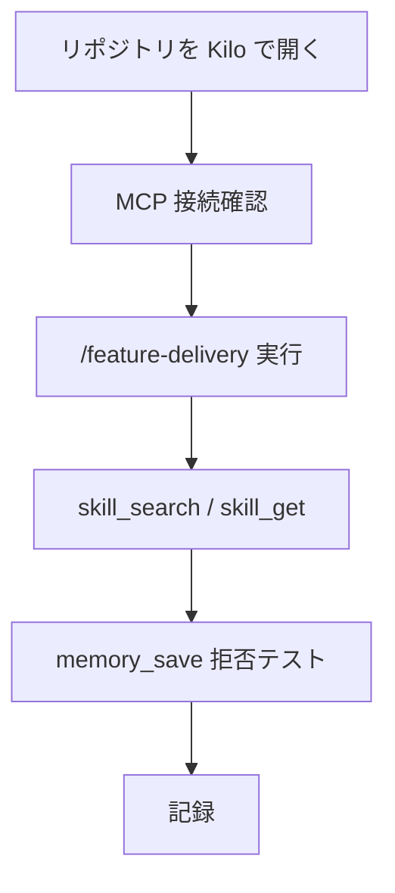

# Kilo 実機 E2E 手順（/feature-delivery + MCP）

> **§0 一文**: Kilo CLI / Kilo Code で本リポジトリを開き、ワークフロー `/feature-delivery` と MCP 能力ツールが連鎖することを手動で確認する。

## 前提

| 項目 | 要件 |
|---|---|
| リポジトリ | `wawoo-skills` をルートで開く |
| Kilo | [Kilo CLI](https://kilo.ai) または [Kilo Code](https://kilocode.ai) |
| Python | 3.10+（`python3 mcp/server.py`） |
| 設定 | ルートの `kilo.json` で MCP `wawoo-skills` が **enabled** |

**実測環境の構築**（Docker / Cursor `agent` / スクリプト）: [CLI-E2E-ENV.md](./CLI-E2E-ENV.md)

## フロー



## 手順

### 1. スモーク（ターミナル）

```bash
cd /path/to/wawoo-skills
python3 scripts/validate_assets.py
python3 mcp/test_server.py
```

**Pass**: 両方 exit 0。

### 2. MCP 接続（Kilo）

1. 本ディレクトリをワークスペースにする。
2. MCP サーバ `wawoo-skills` が起動していることを確認（`kilo.json` の `command`: `python3 mcp/server.py`）。
3. ツール一覧に次が含まれること: `capabilities`, `skill_search`, `skill_get`, `workflow_get`, `agent_get`, `memory_recall`, `memory_save`, `evidence_check`.

**Pass**: `capabilities` を呼び、`code-review` と `/feature-delivery` が一覧に出る。

### 3. `/feature-delivery`（slash ワークフロー）

1. チャットで `/feature-delivery` を実行（または commands から同等を選択）。
2. エージェントが `.kilo/commands/feature-delivery.md` のステップに沿い、少なくとも `to-spec` または `implement` 系 skill を**参照**すること。
3. issue tracker 未設定の場合、`to-spec` / `to-tickets` は **SETUP** 表示またはスキップされ、`readiness.json` の説明に従うこと。

**Pass**: ワークフロー完了または「tracker 未設定でブロック」が**明示**され、無関係な skill だけで終わらない。

### 4. MCP 連鎖

| # | ツール | 入力例 | Pass 条件 |
|---|--------|--------|-----------|
| 1 | `skill_search` | `query: code review` | `code-review` がヒット |
| 2 | `skill_get` | `name: code-review` | 本文が返る、`isError` なし |
| 3 | `workflow_get` | `name: feature-delivery` | command 本文が返る |
| 4 | `evidence_check` | `scope: assets` | `validate_assets` 成功ログ |
| 5 | `memory_save` | `text: sk-12345678901234567890123456789012` | **拒否**（secret detected） |

### 5. 記録

| 項目 | 記入 |
|---|---|
| 日付 | |
| Kilo 版（CLI / Code） | |
| モデル | |
| MCP 接続 | OK / NG |
| /feature-delivery | OK / NG / ブロック理由 |
| MCP 連鎖 1–5 | OK / NG |
| 備考 | |

## 受入（ゲート）

| id | 条件 | Pass |
|---|---|---|
| G1 | ターミナルスモーク 2 本成功 | exit 0 |
| G2 | MCP `capabilities` が 55 skills 規模を返す | 目視 |
| G3 | `/feature-delivery` が command 手順に沿う | 目視 |
| G4 | `memory_save` が秘密を拒否 | `isError` または拒否メッセージ |
| G5 | 結果を上表に記録 | 記入済み |

## 本環境での実行結果（2026-10-25）

| 項目 | 結果 |
|---|---|
| Kilo CLI 実機 | **未実施**（CI/開発環境に `kilo` コマンドなし） |
| `mcp/test_server.py` | **合格**（自動スモーク） |
| 推奨 | 上記手順を Kilo 実機で 1 回走らせ、記録表をこのファイルに追記 |

## 下流

- リリース前: `docs/audit/SKILL-QUALITY-REVIEW.md` の Kilo 行を更新。
- CI: `.github/workflows/validate.yml`（MCP スモークのみ。slash E2E は本手順）。

## 原則自検

| 原則 | 跡 |
|---|---|
| PDCA | 本 doc の手順・受入・記録表 |
| 自己反復 | 実機結果を「本環境での実行結果」に追記 |
| 俊敏 | 自動化はスモークのみ、slash は手動 1 パス |
| チーム協働 | 実行者が記録表を残す |
| 情報暢通 | `kilo.json` / `mcp/README.md` とツール名一致 |
