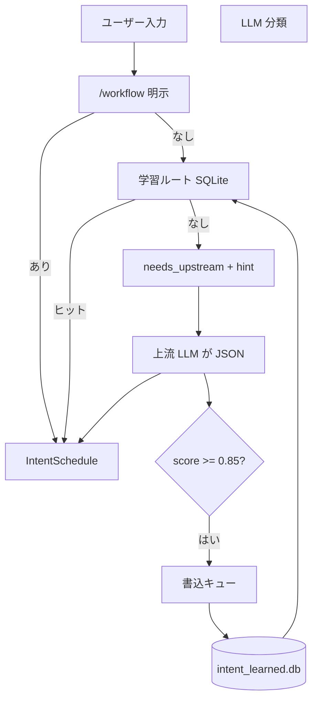

# 意図解釈・意図受信器

§0 **ユーザー入力を常駐の意図受信器が受け取り、意図解釈器で workflow を選び、下流（MCP／Kilo／Cursor）が `@.kilo/commands/<workflow>.md` を起動する。**

**対外ガイド**（利用者向け・手順中心）：[INTENT-ROUTING.md](../INTENT-ROUTING.md)

---

## 1. 他プロジェクトとの関係

**wawoo-skills は汎用キット（単体で完結）**。LLM API ゲートウェイ（例: co.taro.bz）とは**別リポジトリ**。

| 観点 | wawoo-skills |
|------|----------------|
| ホットパス | 載せない（MCP／IDE 入口のみ） |
| 判定 | 会話中モデルの **workflow 適合度 JSON**（専用 LLM API 不要） |
| 学習 | `intent_learned_store.py`（SQLite・非同期） |
| ルート | **L0 明示/command → L1 学習 → L2 スコア → L3 はホストエージェント** |

他製品が同じ意図スタックを使う場合は **`WAWOO_SKILLS_ROOT` で MCP を指す**オプション連携のみ（キット側に API 依存はない）。

---

## 2. フロー



---

## 3. コンポーネント

| パス | 役割 |
|---|---|
| `mcp/intent_catalog.py` | workflow description・MCP 許可集合 |
| `mcp/intent_commands.py` | `.kilo/commands` による L0 slash |
| `mcp/intent_interpreter.py` | オーケストレーション（L0–L2） |
| `mcp/intent_learned_store.py` | 学習済み trigger／安全 regex |
| `mcp/intent_upstream.py` | 上流 LLM 向け最短 JSON 契約 |
| `mcp/intent_learn_queue.py` | SQLite 書込の非同期キュー |
| `mcp/intent_receiver.py` | NDJSON／Unix ソケットで常駐受信 |
| `mcp/intent_client.py` | `WAWOO_INTENT_SOCKET` へ送信 |
| `mcp/intent_session.py` | schedule 確定後の MCP ツールゲート（B3） |
| `mcp/intent_delegation.py` | L3 `delegate_subtask` ペイロード |
| `scripts/task-router.py` | CLI ラッパ |
| MCP `interpret_intent` / `route_task` | ツール呼び出し（既定は MCP 内ローカル解釈） |

---

## 4. 手順

| 段 | 内容 |
|---|---|
| 1 | 常駐起動: `python3 mcp/intent_receiver.py --socket /tmp/wawoo-intent.sock` |
| 2 | 環境変数 `WAWOO_INTENT_SOCKET=/tmp/wawoo-intent.sock` を MCP クライアントに設定 |
| 3 | エージェントは最初に `interpret_intent` を呼ぶ（常駐時のみ `via_receiver: true`） |
| 4 | 返却 `schedule` で MCP **ツールゲート**が有効化（`mcp_tools_allow`） |
| 5 | `workflow_get` → 手順実行。並列サブタスクは `delegate_subtask`（L3） |
| 6 | 終了時 `workflow_clear` でゲート解除 |

stdio のみ: `python3 mcp/intent_receiver.py`（1 行 1 JSON）。

---

## 5. プロトコル（NDJSON）

**要求**

```json
{"id":"req-1","text":"バグを直したい","meta":{}}
```

**応答**

```json
{"id":"req-1","ok":true,"schedule":{"workflow":"delivery-lite","workflow_slash":"/delivery-lite","agent":"implementer",...}}
```

**ヘルス**

```json
{"op":"ping"}
```

---

## 6. 環境変数

| 変数 | 既定 | 説明 |
|---|---|---|
| `WAWOO_INTENT_LEARN_DB` | `data/intent_learned.db` | 学習ルート（任意上書き） |
| `WAWOO_INTENT_SOCKET` | 空 | 常駐受信器（任意） |
| `WAWOO_SKILLS_ROOT` | リポジトリ root | 既存 MCP と同じ |

意図用の LLM API キーは**不要**（判定は Cursor/Kilo の上流モデル）。

**思索モード**: `upstream_prompt` に extended thinking／CoT／`` 禁止を明記。意図分類ターンではユーザー向け自然文も書かない。

---

## 7. ゲート

| id | 条件 | 結果 |
|---|---|---|
| G-1 | 入力が空 | `delivery-lite`・confidence low |
| G-2 | `/workflow` 明示 | その workflow を優先（explicit_override） |
| G-3 | `via_receiver` かつ受信器未起動 | エラー（ソケット接続失敗） |

---

## 8. 受入

| 期待 | Pass |
|---|---|
| `python3 mcp/test_intent.py` 緑 | 全 assert 成功 |
| MCP `interpret_intent` が JSON を返す | `test_server.py` |
| 明示 `/research` が research にルート | 単体テスト |

---

## 9. 下流の読み手

| 読み手 | 用途 |
|---|---|
| エージェント／IDE | MCP ツール |
| シェル | `task-router.py` |
| 運用 | systemd で `intent_receiver` 常駐 |

---

## 10. 原則自検

| 原則 | 跡 |
|---|---|
| PDCA | 本書 §8 受入 |
| 自己反復 | `mcp/test_intent.py` |
| 俊敏 | キーワード表は `intent_interpreter.py` のみ編集 |
| チーム協働 | 受信器＝運用、解釈器＝開発 |
| 情報暢通 | `workflow_slash` と commands stem を一致 |

---

## 11. 更新履歴

| 日付 | 内容 |
|---|---|
| 2026-10-26 | 初版（意図解釈器・常駐受信器・MCP 連携） |
| 2026-10-26 | LLM 主判定・高スコア学習ストア（静的キーワード表を廃止） |
| 2026-10-26 | 監査反映: route_task/needs_scoring、learn 既定 off、promote 検証（`INTENT-RECEIVER-AUDIT.md`） |
| 2026-10-26 | カタログ L0–L2・B3 ゲート・L3 delegate・対外 `INTENT-ROUTING.md` |
